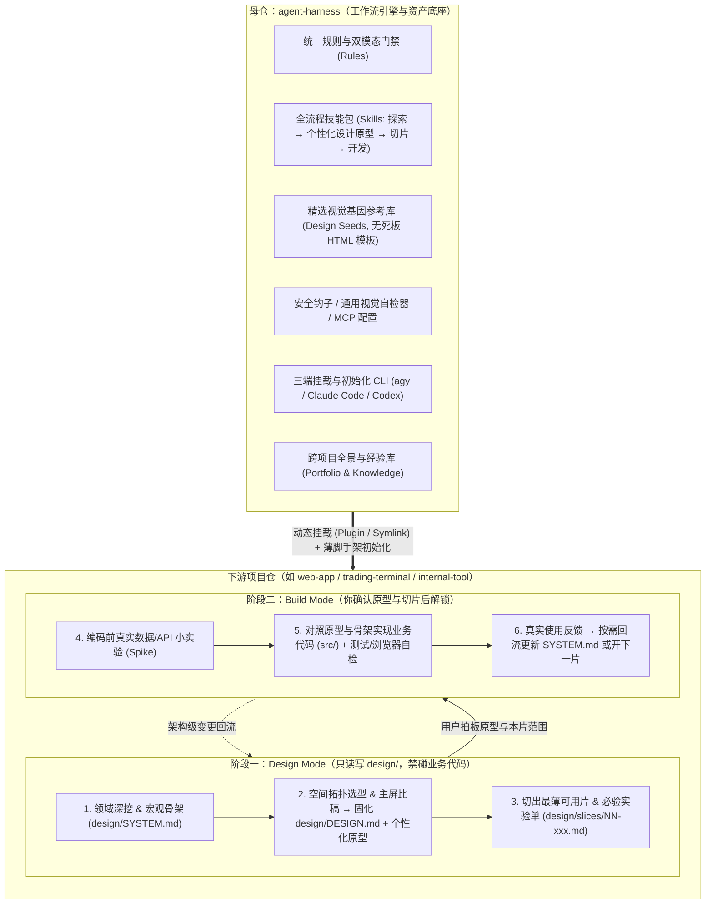

# 通用 AI 工程工作流母仓（Agent Harness）架构蓝图

> **状态**：核心底座已定稿落地，支持跨项目通用挂载与多领域技能包演进  
> **创建日期**：2026-11-12  
> **演进背景**：源于早期双仓分离工作空间六周高强度实战后的系统性复盘与通用化重构

---

## 一、背景与重构初衷

早期探索阶段曾将“设计空间”与“开发空间”物理拆分为两个独立仓库，在六周实践中暴露出四个核心矛盾：

1. **物理分仓导致“真数据盲区”与高昂交接税**：设计仓看不到真实 API 数据与现有代码结构，AI 凭记忆编细节导致交接后频繁返工；每次变更需走繁琐的跨仓拷贝、打标签、断链校验与双向反馈清单同步。
2. **原型定位摇摆且被单一后台外壳绑死**：前期追求“全系统百条验收场景一次打磨完”压垮注意力；后期矫枉过正改为“粗原型不打磨、不指导开发”，且所有项目强制套用同一套左侧栏后台模板，导致严重路径依赖（如交易终端长成后台管理系统），丧失了**“先出原型指导后续开发”**的核心价值。
3. **产品原型与评审元数据耦合**：把系统地图、设计说明、走查高亮（`TOURS`）、验收场景全部揉进原型自身的 DOM 与手写 JS 中，维护沉重，开发阶段难以直接参考转译前端组件。
4. **文档与规则打补丁式膨胀**：每个项目维护 5–6 份 Markdown 加多份原型 JS，规则叠床架屋甚至前后冲突，主对话上下文被文档同步吞噬。

---

## 二、已确认的核心架构决定

| 编号 | 维度 | 已拍板决定 | 核心理由 |
| :--- | :--- | :--- | :--- |
| **D1** | **空间拆分策略** | **单项目内“设计 + 原型 + 开发”同仓闭环（`design/` + `src/`），不再物理拆成两个业务仓库** | 消除跨仓拷贝税与真数据盲区；用**阶段门禁（Design Mode ↔ Build Mode）**替代物理隔离，防止 AI 抢跑写代码 |
| **D2** | **本仓库定位** | **`agent-harness` 作为跨项目、跨领域的“通用 AI 工程工作流母仓（Harness Hub）”** | 将通用方法论（Rules / Skills / Guards / CLI / 经验模式卡）与具体业务项目及个人私有信息彻底解耦，一处升级、多类项目复用 |
| **D3** | **多端工具兼容** | **同时适配 Antigravity (`agy`)、Claude Code、OpenAI Codex 三端，优先采用动态引用/软链接而非硬拷贝副本** | 避免多业务项目出现多份技能副本导致版本撕裂；兼顾日常在不同 AI 编程工具间切换的灵活性 |
| **D4** | **原型技术形态 (M3)** | **零模板个性化设计（`design/DESIGN.md` 视觉基因 + 本地 `tokens.css` + 零构建静态交互原型 + 无侵入悬浮状态胶囊）** | 彻底废除固定页面模板（杜绝“左侧菜单+右侧卡片”后台风惯性）；内化 GitHub 高星审美体系（`awesome-design-md` / `taste-skill` / `frontend-design` / `impeccable`），先做主屏双方向视觉比稿定调 `DESIGN.md`，再展开原型并持续指导后续正式前端代码 |
| **D5** | **双模态门禁 (M1)** | **显式模式状态（`Mode: design \| build`）+ 三道防线（事前拦截 / 事后核对 / 提交兜底）** | `AGENTS.md` 声明当前模式；`design` 模式下由工具钩子事前拦截对业务代码的写入（`PreToolUse`，文件按白名单、终端命令按词元识别写入目标），终端命令跑完后核对工作区实际改动（`PostToolUse` / `ws check`，兜住事前看不穿的脚本与脚手架），提交时再兜底（`pre-commit`）；是否解锁按“改完后的 `Mode`”判定并交用户确认，拍板切片后切至 `build` |
| **D6** | **原型生命周期 (M1)** | **按改动量级分流：0→1 与新大模块先出原型，1→N 局部迭代直改真实应用** | 已有真实页面后不再双轨维护静态 HTML 原型，仅在触及子系统边界或数据正本变更时同步更新 `design/SYSTEM.md` |
| **D7** | **探索分级与节拍 (M2)** | **L1/L2/L3 复杂度自适应分流 + 图文面包板辅助单向门 + 骨架两段锁定（v0.1→原型回流→v1.0）** | 避免小工具走繁重仪式；涉及交互流派的单向门配 10 行级 ASCII 分区草图辅助判断；`SYSTEM.md` 保持 ~200 行现行态，超量历史决策归档 `design/decisions.md` |
| **D8** | **调研与只读探针边界 (M2)** | **四级证据打标 + 同仓存量代码盘点 + 隔离目录（`/tmp`）零凭证公开只读探针** | 防止子代理摘要洗白与脱离既有代码底座；设计期允许免鉴权公开端点采样核实字段，需密钥/付费/写操作的实验一律转入 Build Spike |
| **D9** | **AI 原生记忆与防偷懒门禁 (M4)** | **薄路由 `TECH.md` + 模块就近契约 `src/<mod>/AGENTS.md`（≤40行）+ 可执行 `scripts/check` 阻断假实现** | 顺应 AI 跨会话失忆特性，按目录层级自动按需注入模块边界与不变量；拦截未备案 `TODO/mock` 残留、跨层越界与空异常；算钱逻辑先行手算测试 |
| **D10** | **务实 UI 还原与对抗审查 (M4)** | **源头导入 `tokens.css` + 仅测功能可用与无严重破版（不做像素级微瑕纠偏）+ 零上下文/跨模型 Diff 审查** | 不把时间和 Token 消耗在 2px 字号或微弱色差等像素警察检查上；真数据探针由子代理隔离试错；关键切片支持调异构模型 CLI 交叉挑刺 |
| **D11** | **三端零撕裂挂载与 CLI (M5)** | **单技能软链接（本机产物忽略入库）+ 两段式薄 `AGENTS.md` + 同核三端钩子 + `ws line` 并行开发线管理** | 兼容 `agy` / Claude Code / Codex；单技能软链接写入下游 `.gitignore` 兼顾母仓秒同步、并行开发线（`git worktree`）层级兼容与项目自有技能保留；内置 `ws line new/list/check/sync/rm` 实现主干 `design` 守门、多需求独立工作树本地 `build`、防文件碰撞与门禁合流闭环；入库文件零本机隐私路径，由 `ws init/mode/line/check/link/sync/promote/doctor` 统一管理 |
| **D12** | **知识活水化与公私分离 (M6)** | **流程经验内化入技能 + 领域经验转为触发式模式卡 + `global-principles.md` 通用底线 + 本机可选 `PORTFOLIO.local.md` + `sandbox/` 孵化迁出** | 消灭死文档库并剥离个人本机路径隐私；母仓在 Git 中保持 100% 通用，私有跨仓地图留在 `.gitignore` 保护的本地文件中 |
| **D13** | **多领域扩展边界** | **“通用内核 + 可选技能包（Packs）”留在单母仓；具体服务器运维与业务数据代码另建下游仓** | 部署发布、故障排障、数据分析的 AI 技能与检查器共享同一套 `bin/ws` 三端挂载与密钥门禁（后续按 `--profile` 选配挂载避免污染纯数据/运维仓）；真实基础设施配置与具体数据分析工程独立建仓 |

---

## 三、整体运作模型

---

## 四、六大模块及当前状态

六个模块的边界与关键设计决定均已确认并落地；后续演进按模块回到本表修订：

| 顺序 | 模块名称 | 核心要解决的问题 | 当前状态 |
| :--- | :--- | :--- | :--- |
| **M1** | **双模态协作宪章与业务仓结构** | 业务仓收敛为 `AGENTS.md` + `design/{SYSTEM.md, prototype/, slices/, research/}` + `src/`；通过显式 `Mode` 状态与三道防线门禁隔离设计与编码；1→N 局部改动直改真页面 | **已确认** |
| **M2** | **领域探索与宏观架构技能** | L1/L2/L3 复杂度分流；存量代码+外部四源深挖（四级证据标签、标杆屏幕分区拆解）；ASCII 面包板辅助单向门；`/tmp` 零凭证只读探针；`SYSTEM.md` + 按需 `decisions.md` | **已确认** |
| **M3** | **高拟真原型工程与设计品味体系** | 彻底废除固定页面模板；内化 `awesome-design-md` / `taste-skill` / `frontend-design` / `impeccable` 精华；按业务特色选空间拓扑 → 主屏双变体比稿 → 沉淀 `design/DESIGN.md` 与 `tokens.css` → 无侵入状态胶囊 + 截图精修 | **已确认** |
| **M4** | **垂直切片、真数据验证与开发闭环** | `Slice 00` 先打通真环境启动入口与 `TECH.md`；模块就近契约 `src/<mod>/AGENTS.md`；子代理隔离真数据探针；源头复用 `tokens.css` 但不做像素级苛刻检查，聚焦功能点通与反假实现 `scripts/check`；零上下文/跨模型 Diff 审查 | **已确认** |
| **M5** | **三端适配与 CLI 同步架构** | 相对路径单技能软链接（`.agents/skills/*` + `.claude/skills` 桥接）、两段式薄 `AGENTS.md`、同核安全钩子（`mode_guard.py` + `check_secrets.py`）、本机全局按需 MCP，配 `ws` 全生命周期子命令 | **已确认** |
| **M6** | **跨项目经验、公私分离与孵化沙盒** | 流程经验编译进技能与检查器，6 类领域经验提纯为触发式模式卡；通用工程底线入 `global-principles.md`，私有项目地图走本机忽略的 `PORTFOLIO.local.md`；`sandbox/` 承接早期脑暴并支持 `ws promote` 毕业建仓 | **已确认** |

---

## 五、设计原则（本母仓自身遵守的底线）

1. **反官僚主义**：每增加一份文档模板或一条规则，必须回答“没有它会出什么不可挽回的错”；能靠目录结构、代码检查脚本和阶段门禁解决的，绝不写成几百行叮嘱文字。
2. **注意力优先**：主对话窗口永远优先服务于用户的认知与决策（看图、做单向门取舍、看真实运行效果），把海量资料检索、DOM 检查、跨视角挑刺下放给后台脚本或子代理。
3. **单一事实源**：无论在母仓与业务仓之间，还是在业务仓内的原型与文档之间，同一个决定只写一处，拒绝人工多处同步。
